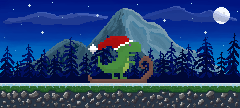

# Dino Ski

Un dino à skis dévale la montagne. Il avance tout seul : à toi de sauter au bon moment.

## Règles
- Le dino avance tout seul vers la droite.
- Appuie sur **A** pour sauter, **la croix** (gauche/droite) pour te décaler.
- Solo : va le plus loin possible en 3:00 (pas de ligne d'arrivée). À deux : le premier à 600 M gagne ; après 2:30, le plus loin gagne.
- Obstacles au sol (tas de neige, bonhomme de neige) : saute par-dessus. Oiseaux : ils volent juste au-dessus de ta tête, ne saute pas dessous ! Chaque choc te ralentit.
- Tous les 100 M, le dino accélère. Solo : +20 %, puis +19 %, +18 %... (x3 à 700 M), et la vitesse ne bouge plus après 1500 M. À deux : +10 % à chaque palier.

## Pièges (à deux seulement)
- Toutes les 15 secondes, tu reçois un piège au hasard dans le cercle en haut à droite de ton écran.
- Appuie sur **B** pour le lancer sur l'autre joueur : il arrive par la droite de son écran.
- **Projectile bleu** : paralyse le dino touché pendant 2 secondes.
- **Boule de neige** : fait sauter le dino touché : lance-la quand un oiseau arrive sur lui !
- Saute par-dessus un projectile pour l'esquiver.

## Équipe
- À compléter (noms et rôles).

## Crédits
- `src/assets/obstacles/Oiseau.png` : oiseau volant, dessiné par l'équipe.
- `src/assets/pieges/glace.png` : piège de glace (paralyse), dessiné par l'équipe.
- `src/assets/pieges/boule-neige.png` : piège boule de neige, dessiné par l'équipe.
- `src/assets/logo.png` : logo du jeu (dino au bonnet de Noël), dessiné par l'équipe.
- `src/assets/sons/musique.mp3` : musique de fond, fournie par l'équipe.
- `src/assets/dino.svg` : dino provisoire, dessiné pour le projet.
